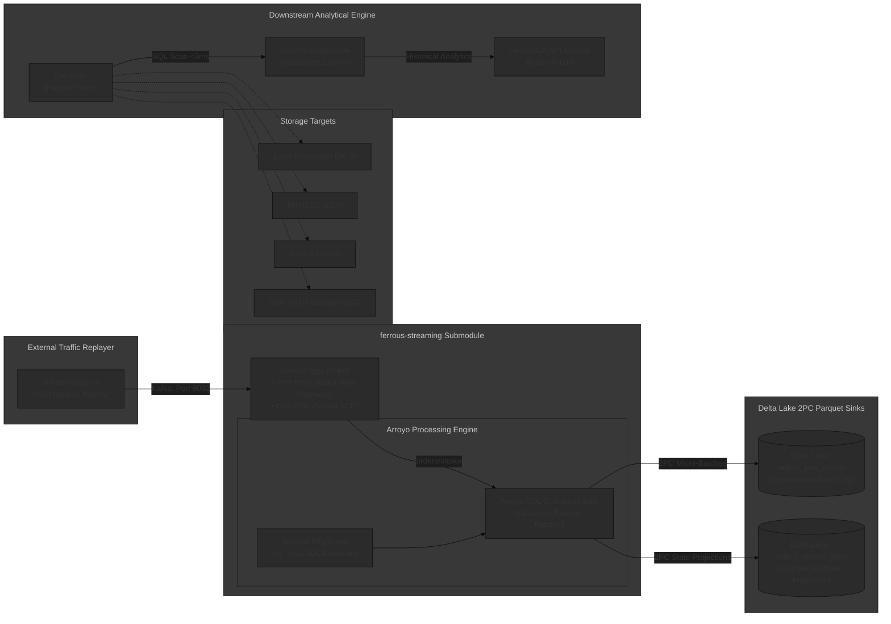

# ferrous-streaming

[← Back to FerrousCX Root Architecture](https://github.com/reidlai/ferrous-cx)

[](https://github.com/reidlai/ferrous-cx)
[](LICENSE)
[](https://github.com/reidlai/ferrous-cx/blob/main/.github/workflows/devsecops-infra-ci.yml)
[](#container-security--devsecops)
[](#system-architecture)

**`ferrous-streaming`** is the dedicated streaming data ingestion and lakehouse ETL submodule of the **FerrousCX** enterprise platform. It packages and orchestrates **Apache Iggy** (high-throughput Write-Ahead Log streaming broker) and **Arroyo** (Rust-native stateful stream processing engine) into containerized services.

This submodule packages and runs the streaming engine and broker runtime, orchestrating Arroyo SQL pipelines, schema migration scripts, and transactional two-phase commit (2PC) Parquet sinks to **Delta Lake**, while historical dataset replay configurations are driven externally by **`stream-replay-rs`** (supporting Kafka, NATS JetStream, and Fluvio).

---

## 🏛️ System Architecture



> **Note on Pipeline Boundaries:** The **FerrousCX API Service (Rust / Axum)** connects to **Apache DataFusion** to query this Delta Lake Arroyo storage **strictly for historical streaming datasets** (e.g. Olist historical transactions, reviews, delivery logs). Live transactional commands and state changes bypass this pipeline and are handled strictly by the CQRS-ES pattern in **`ferrous-cqrses`**.

### Communication Protocols & Ports

| Component | Port | Protocol | Purpose |
| :--- | :--- | :--- | :--- |
| **Apache Iggy (Kafka Gateway)** | `9092` | Kafka Wire Protocol (TCP) | Ingestion sink for `stream-replay-rs` and Kafka producers |
| **Apache Iggy (Native TCP)** | `8090` | Iggy Custom Binary Protocol | High-performance, low-latency management and streaming |
| **Apache Iggy (HTTP Management)** | `3000` | HTTP / REST | Health probe (`/ping`), Auth (`/users/login`), and `/metrics` |
| **Arroyo Web Dashboard** | `5115` | HTTP / WebSocket | Stream pipeline monitoring, metrics, and checkpoint inspection |

---

## ⚡ Key Capabilities

1. **Dedicated Historical Data Ingestion Broker:**
   * Pre-configured Apache Iggy stream topologies (`orders/intake`, `orders/consolidated`) optimized for sub-millisecond fsync ingestion and zero-copy consumer groups.
   * Native Kafka protocol gateway allowing external producer tools (like `stream-replay-rs`) to publish events with zero custom dependencies.
2. **Schema Versioning & SQL Migrations as Code:**
   * Versioned SQL DDL scripts (`migrations/001_initial_olist_schema.sql`, `migrations/002_add_delivery_sla_fields.sql`).
   * Manages stream schema evolution without downtime, schema drift, or corrupted Parquet files.
3. **Turnkey Delta Lake 2PC Parquet Sinks:**
   * Configured Arroyo two-phase commit (2PC) Parquet sink connectors ensuring transactional ACID micro-batch commits (`_delta_log/`).
   * Pluggable storage abstraction supporting local NVMe storage (`file://`), MinIO (`s3://`), AWS S3, and Google Cloud Storage (`gs://`).
4. **Zero-Python, Zero-JVM Footprint:**
   * Compiled native Rust executables throughout; operates with minimal memory overhead (<200MB combined RSS).

---

## 🛠️ Standalone Developer Quickstart

You can build and test `ferrous-streaming` in Standalone Mode using Docker Compose:

### Prerequisites

* **Docker & Docker Compose:** `v2.29+`
* **Pre-commit:** `3.8+` (`pip install pre-commit` or `pipx install pre-commit`)

### 1. Launch the Streaming Stack

```bash
# Clone the repository
git clone https://github.com/reidlai/ferrous-streaming.git
cd ferrous-streaming

# Install local pre-commit hooks
pre-commit install

# Boot Apache Iggy and Arroyo locally
docker compose up -d

# Verify services are healthy
docker compose ps
```

* **Apache Iggy Kafka Gateway:** `localhost:9092`
* **Apache Iggy Native TCP:** `localhost:8090`
* **Apache Iggy HTTP Health Check:** `http://localhost:3000/ping` (`pong`)
* **Apache Iggy Prometheus Metrics:** `http://localhost:3000/metrics` (Requires Bearer token)
* **Arroyo Web UI:** `http://localhost:5115`

### 2. Provision Ingestion Topics & Partition Durability

Idempotently initialize stream `orders` and partitioned topics (`intake` and `consolidated`, 4 partitions each) with immediate `fsync` persistence:

```bash
# POSIX Bash
./scripts/provision-topics.sh

# PowerShell
.\scripts\provision-topics.ps1
```

### 3. Provision Zero-Copy Consumer Groups

Idempotently provision consumer groups for decoupled stream processing and command consumption (`cg-arroyo-raw`, `cg-cmd-handler`, and `cg-arroyo-state`):

```bash
# POSIX Bash
./scripts/provision-consumer-groups.sh

# PowerShell
.\scripts\provision-consumer-groups.ps1
```

### 4. Verify Arroyo Stream Processor & Broker Ingestion

Verify that the Arroyo Stream Processor (port 5115) is healthy and authenticated to Apache Iggy via `svc_ferrous_streaming`, attaching consumer groups `cg-arroyo-raw` and `cg-arroyo-state`:

```bash
# POSIX Bash
./scripts/provision-arroyo.sh

# PowerShell
.\scripts\provision-arroyo.ps1
```

### 5. Run Schema Migrations & Deploy Streaming Pipelines

Deploy both Arroyo streaming pipelines (Pipeline 1: `raw_event_archiver` connecting to `orders/intake` via `cg-arroyo-raw`; Pipeline 2: `state_snapshot_consolidator` connecting to `orders/consolidated` via `cg-arroyo-state`):

```bash
# POSIX Bash (Deploys both pipelines sequentially)
./scripts/run-migrations.sh

# Or deploy individual pipelines:
./scripts/deploy-pipeline-raw-archiver.sh
./scripts/deploy-pipeline-state-consolidator.sh

# PowerShell (Deploys both pipelines sequentially)
.\scripts\run-migrations.ps1

# Or deploy individual pipelines:
.\scripts\deploy-pipeline-raw-archiver.ps1
.\scripts\deploy-pipeline-state-consolidator.ps1
```

---

## 🛡️ Container Security & DevSecOps (AD-13)

This infrastructure submodule adheres strictly to the **Tier 2 DevSecOps Standards**:

* **Local Pre-Commit Guardrails (`.pre-commit-config.yaml`):**
  - Dockerfile linting via `hadolint` (enforcing non-root execution, explicit tag pinning, no `:latest`).
  - Shell script linting via `shellcheck`.
  - Secret scanning via `gitleaks` to block committed credentials.
* **Tier 2 DevSecOps CI Pipeline ([`devsecops-infra-ci.yml`](https://github.com/reidlai/ferrous-cx/blob/main/.github/workflows/devsecops-infra-ci.yml)):**
  - **Base Image SCA:** **Trivy** scanning base images (Debian/Alpine/Rust) for OS-level CVEs, failing on unpatched **HIGH** or **CRITICAL** vulnerabilities.
  - **Configuration SAST:** **Hadolint** and **Trivy config** inspecting Dockerfiles and compose files.
  - **Smoke Verification:** Automated `docker build` validation on every pull request.

---

## ⚙️ Configuration & Environment Variables Reference

| Environment Variable | Default Value | Description | Required |
| :--- | :--- | :--- | :--- |
| `IGGY_KAFKA_PORT` | `9092` | Port for Kafka-compatible wire protocol gateway | No |
| `IGGY_TCP_PORT` | `8090` | Port for native Apache Iggy TCP transport | No |
| `ARROYO_API_PORT` | `5115` | Port for Arroyo Web Dashboard and REST API | No |
| `DELTA_STORAGE_URI` | `file:///data/delta` | Storage destination URI (`file://`, `s3://`, `gs://`) | No |
| `AWS_ENDPOINT_URL` | *None* | Custom S3 endpoint URL (for MinIO) | If using MinIO |
| `AWS_ACCESS_KEY_ID` | *None* | AWS / MinIO Access Key ID | If using S3 |
| `AWS_SECRET_ACCESS_KEY` | *None* | AWS / MinIO Secret Access Key | If using S3 |
| `GOOGLE_APPLICATION_CREDENTIALS` | *None* | Path to GCP service account key | If using GCS |
