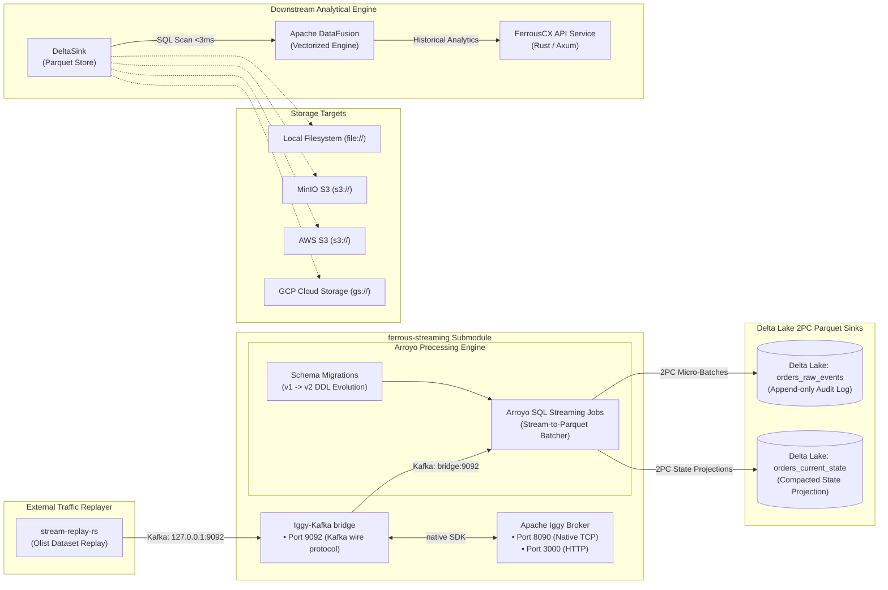

# ferrous-streaming

[← Back to FerrousCX Root Architecture](https://github.com/reidlai/ferrous-cx)

[](https://github.com/reidlai/ferrous-cx)
[](LICENSE)
[](https://github.com/reidlai/ferrous-cx/blob/main/.github/workflows/devsecops-infra-ci.yml)
[](#container-security--devsecops)
[](#system-architecture)

**`ferrous-streaming`** is the **consolidated data platform** of the **FerrousCX** enterprise platform. One repository packages and orchestrates **Apache Iggy** (high-throughput Write-Ahead Log streaming broker), **Arroyo** (Rust-native stateful stream processing engine), the **Delta store** (`store/`) and a standalone **Apache DataFusion** query service, together with the platform's HPC benchmark. They are deployed as one compose deliverable of separate services, not merged into one process. The former `ferrous-lakehouse` and `ferrous-query-engine` repositories are retired into this one.

This submodule packages and runs the streaming engine and broker runtime, orchestrating Arroyo SQL pipelines, schema migration scripts, and transactional two-phase commit (2PC) Parquet sinks to **Delta Lake**, while dataset replay is performed externally by the generic, platform-agnostic **`stream-replay-rs`**. Topic names, replay profiles and the Olist dataset are owned by `ferrous-cx`, which provisions the topics this platform consumes.

---

## 🏛️ System Architecture



> **Note on Pipeline Boundaries:** The **FerrousCX API Service (Rust / Axum)** connects to **Apache DataFusion** to query this Delta Lake Arroyo storage **strictly for historical streaming datasets** (e.g. Olist historical transactions, reviews, delivery logs). Live transactional commands and state changes bypass this pipeline and are handled strictly by the CQRS-ES pattern in **`ferrous-cqrses`**.

### Communication Protocols & Ports

| Component | Port | Protocol | Purpose |
| :--- | :--- | :--- | :--- |
| **Iggy-Kafka bridge** | `9092` | Kafka Wire Protocol (TCP) | The platform's only Kafka endpoint: Arroyo reads through it on the compose network (`bridge:9092`), `stream-replay-rs` publishes through it on host loopback (`127.0.0.1:9092`). Never published on all interfaces. |
| **Apache Iggy (Native TCP)** | `8090` | Iggy Custom Binary Protocol | High-performance, low-latency management and streaming |
| **Apache Iggy (HTTP Management)** | `3000` | HTTP / REST | Health probe (`/ping`), Auth (`/users/login`), and `/metrics` |
| **Arroyo Web Dashboard** | `5115` | HTTP / WebSocket | Stream pipeline monitoring, metrics, and checkpoint inspection |
| **DataFusion Query Service** *(planned)* | `50051` | Arrow Flight SQL (gRPC) | Analytical SQL over the Delta store for consumers other than `ferrous-api` |
| **DataFusion Query Service** *(planned)* | `8085` | HTTP | Query and health endpoints of the same service |

> [!WARNING]
> **Iggy-Kafka bridge status: configured, not yet run.** The Iggy server does not speak Kafka, so Arroyo and the replayer reach Iggy through the bridge (AD-28): the upstream Apache Iggy `iggy-gateway-kafka` image, pinned by digest and configured here, not built here. It is pre-release (only `edge` tags exist). The compose services, topic map, user permissions and pipeline settings below are checked by unit tests, but **nothing has been started or tested against a running stack**: the live checks L1-L14 of the Bridge Contract Sheet are open (`OPEN Bridge Compatibility`). Expect to change this configuration when they run. The Iggy server image (`apache/iggy:latest`, 0.9) is also older than the gateway requires for its offset commits; Arroyo's commits are best effort and its data path does not depend on them, but check it first (L7).

### Iggy-Kafka bridge

Contract: the Bridge Contract Sheet in `ferrous-cx/contracts/` (draft). Topic names and consumer groups come from `ferrous-cx/contracts/topics.yml`.

| Piece | Where | What it does |
| :--- | :--- | :--- |
| `bridge` service | `docker-compose.yml` | Gateway instance for the compose network, advertises `bridge:9092`. Arroyo waits for it to be healthy. |
| `bridge-host` service | `docker-compose.yml` | A second instance of the same image, published on `127.0.0.1:9092` only and advertising that address, for the host-run replayer. The gateway allows one listener per protocol, so two instances are the way to get two advertised addresses. |
| `config/bridge/topic-map.toml` | generated | Maps Kafka names (`orders.intake`, `orders.consolidated`, `olist.orders_stream`) to Iggy `{stream, topic}`. Any other name resolves to an empty default stream and fails with `UNKNOWN_TOPIC_OR_PARTITION`. Auto-creation of topics is off. |
| `scripts/generate-bridge-topic-map.py` | script | Regenerates the map from `topics.yml`; `--check` fails when it is stale. |
| `scripts/provision-bridge-user.py` | script | Builds (dry run) or creates the Iggy user of the bridge. This user is the produce allowlist: it may send only to topics marked `kafka.produce: true` (`olist/orders_stream`), and has no `manage_*` permission, so Kafka CreateTopics, DeleteTopics and AlterConfigs are refused. |

Set `BRIDGE_IGGY_USERNAME` and `BRIDGE_IGGY_PASSWORD` in `.env` (never in the compose file) and create the user before starting the bridge.

**Delivery.** A produce is acknowledged after Iggy confirms the append; with Iggy's default topic durability (`replicated`) that does not include an fsync, so `olist/orders_stream` should be created `persisted`. Producer idempotence is off, so a retried produce can store a record twice; the replayer's `replay.run_id` and `replay.seq` headers identify duplicates. Consumers get at-least-once from the bridge and exactly-once in Delta through Arroyo's checkpoints and two-phase commit.

---

## ⚡ Key Capabilities

1. **Dedicated Historical Data Ingestion Broker:**
   * Pre-configured Apache Iggy stream topologies for the topics provisioned by `ferrous-cx` (`olist/orders_stream`, `orders/intake`, `orders/consolidated`), optimized for sub-millisecond fsync ingestion and zero-copy consumer groups.
   * An Iggy-Kafka bridge (the upstream Apache Iggy Kafka gateway, configured here) that lets Arroyo and producer tools like `stream-replay-rs` use plain Kafka clients against Iggy (not yet run, see the status note).
2. **Schema Versioning & SQL Migrations as Code:**
   * Versioned SQL DDL scripts (`migrations/001_initial_olist_schema.sql`, `migrations/002_add_delivery_sla_fields.sql`).
   * Manages stream schema evolution without downtime, schema drift, or corrupted Parquet files.
3. **Turnkey Delta Lake 2PC Parquet Sinks:**
   * Configured Arroyo two-phase commit (2PC) Parquet sink connectors ensuring transactional ACID micro-batch commits (`_delta_log/`).
   * Pluggable storage abstraction supporting local NVMe storage (`file://`), MinIO (`s3://`), AWS S3, and Google Cloud Storage (`gs://`).
4. **Zero-Python, Zero-JVM Footprint:**
   * Compiled native Rust executables throughout; operates with minimal memory overhead (<200MB combined RSS).

---

## Delta Store (`store/`)

The Delta Lake table definitions, retention config, and `init-tables` / `optimize` / `vacuum` scripts live in `store/`, relocated from the former `ferrous-lakehouse` repository with history preserved. Arroyo writes the streaming tables; the `delta-store` compose service initializes and maintains them. See `store/README.md`.

---

## HPC Benchmark (`benchmark/`, planned)

The platform's high-performance benchmark is public and lives here, based on the workload and method of **HPC-MQBench**. It measures the FerrousCX platform end to end, and a run counts only when every record is accounted for. It uses the generic `stream-replay-rs` as its load driver (the `ferrous-cx` load profile, `--rate 25`, or a rate set by the benchmark) and holds no benchmark knowledge in the replayer.

Published third-party broker figures, with their conditions and caveats, are kept in [`docs/published-broker-figures.md`](docs/published-broker-figures.md). They are not results of this benchmark.

---

## 🛠️ Standalone Developer Quickstart

You can build and test `ferrous-streaming` in Standalone Mode using Docker Compose:

### Prerequisites

* **Docker & Docker Compose:** `v2.29+`
* **Pre-commit:** `3.8+` (`pip install pre-commit` or `pipx install pre-commit`)

### 1. Launch the Streaming Stack

```bash
# Clone the repository
git clone https://github.com/reidlai/ferrous-streaming.git
cd ferrous-streaming

# Install local pre-commit hooks
pre-commit install

# Boot Apache Iggy and Arroyo locally
docker compose up -d

# Verify services are healthy
docker compose ps
```

* **Iggy-Kafka bridge (host loopback):** `127.0.0.1:9092`
* **Apache Iggy Native TCP:** `localhost:8090`
* **Apache Iggy HTTP Health Check:** `http://localhost:3000/ping` (`pong`)
* **Apache Iggy Prometheus Metrics:** `http://localhost:3000/metrics` (Requires Bearer token)
* **Arroyo Web UI:** `http://localhost:5115`

### 2. Provision Ingestion Topics & Partition Durability

Idempotently initialize stream `orders` and partitioned topics (`intake` and `consolidated`, 4 partitions each) with immediate `fsync` persistence:

```bash
# POSIX Bash
./scripts/provision-topics.sh

# PowerShell
.\scripts\provision-topics.ps1
```

### 3. Provision Zero-Copy Consumer Groups

Idempotently provision consumer groups for decoupled stream processing and command consumption (`cg-arroyo-raw`, `cg-cmd-handler`, and `cg-arroyo-state`):

```bash
# POSIX Bash
./scripts/provision-consumer-groups.sh

# PowerShell
.\scripts\provision-consumer-groups.ps1
```

### 4. Verify Arroyo Stream Processor & Broker Ingestion

Verify that the Arroyo Stream Processor (port 5115) is healthy and authenticated to Apache Iggy with its own native credentials (these services are not Kanidm clients), attaching the consumer groups `cg-arroyo-olist` (`olist/orders_stream`), `cg-arroyo-raw` (`orders/intake`) and `cg-arroyo-state` (`orders/consolidated`):

```bash
# POSIX Bash
./scripts/provision-arroyo.sh

# PowerShell
.\scripts\provision-arroyo.ps1
```

### 5. Run Schema Migrations & Deploy Streaming Pipelines

Deploy both Arroyo streaming pipelines (Pipeline 1: `raw_event_archiver` connecting to `orders/intake` via `cg-arroyo-raw`; Pipeline 2: `state_snapshot_consolidator` connecting to `orders/consolidated` via `cg-arroyo-state`):

```bash
# POSIX Bash (Deploys both pipelines sequentially)
./scripts/run-migrations.sh

# Or deploy individual pipelines:
./scripts/deploy-pipeline-raw-archiver.sh
./scripts/deploy-pipeline-state-consolidator.sh

# PowerShell (Deploys both pipelines sequentially)
.\scripts\run-migrations.ps1

# Or deploy individual pipelines:
.\scripts\deploy-pipeline-raw-archiver.ps1
.\scripts\deploy-pipeline-state-consolidator.ps1
```

---

## 🛡️ Container Security & DevSecOps (AD-13)

This infrastructure submodule adheres strictly to the **Tier 2 DevSecOps Standards**:

* **Local Pre-Commit Guardrails (`.pre-commit-config.yaml`):**
  - Secret scanning via `gitleaks` to block committed credentials.
  - File formatting and syntax checks (`check-yaml`, `check-toml`, trailing whitespace, end-of-file).
  - Automated local execution of all 9 unit and integration test suites.
* **Local Container Build & Trivy Vulnerability Scanning (`build-and-scan`):**
  - **Base Image SCA:** **Trivy** scanning base images (Alpine/Debian) for OS-level CVEs, failing on unpatched **HIGH** or **CRITICAL** vulnerabilities.
  - Zero cloud CI minute consumption for free GitHub accounts.
  ```bash
  # POSIX Bash
  ./scripts/build-and-scan.sh

  # PowerShell
  .\scripts\build-and-scan.ps1
  ```

---

## ⚙️ Configuration & Environment Variables Reference

| Environment Variable | Default Value | Description | Required |
| :--- | :--- | :--- | :--- |
| `BRIDGE_IGGY_USERNAME` | `svc_kafka_bridge` | Iggy user of the Iggy-Kafka bridge | No |
| `BRIDGE_IGGY_PASSWORD` | *None* | Password of that Iggy user (set in `.env`) | Yes, to start the bridge |
| `IGGY_TCP_PORT` | `8090` | Port for native Apache Iggy TCP transport | No |
| `ARROYO_API_PORT` | `5115` | Port for Arroyo Web Dashboard and REST API | No |
| `DELTA_STORAGE_URI` | `file:///data/delta` | Storage destination URI (`file://`, `s3://`, `gs://`) | No |
| `AWS_ENDPOINT_URL` | *None* | Custom S3 endpoint URL (for MinIO) | If using MinIO |
| `AWS_ACCESS_KEY_ID` | *None* | AWS / MinIO Access Key ID | If using S3 |
| `AWS_SECRET_ACCESS_KEY` | *None* | AWS / MinIO Secret Access Key | If using S3 |
| `GOOGLE_APPLICATION_CREDENTIALS` | *None* | Path to GCP service account key | If using GCS |
