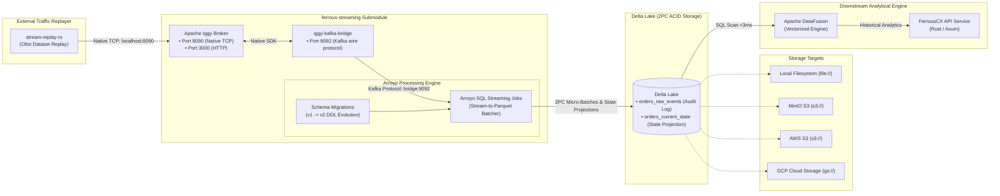

# ferrous-streaming

[← Back to FerrousCX Root Architecture](https://github.com/reidlai/ferrous-cx)

[](https://github.com/reidlai/ferrous-cx)
[](LICENSE)
[](https://github.com/reidlai/ferrous-cx/blob/main/.github/workflows/devsecops-infra-ci.yml)
[](#container-security--devsecops)
[](#system-architecture)

**`ferrous-streaming`** is the **consolidated data platform** of the **FerrousCX** enterprise platform. One repository packages and orchestrates **Apache Iggy** (high-throughput Write-Ahead Log streaming broker), **Arroyo** (Rust-native stateful stream processing engine), the **Delta store** (`store/`) and a standalone **Apache DataFusion** query service, together with the platform's HPC benchmark. They are deployed as one compose deliverable of separate services, not merged into one process. The former `ferrous-lakehouse` and `ferrous-query-engine` repositories are retired into this one.

This submodule packages and runs the streaming engine and broker runtime, orchestrating Arroyo SQL pipelines, schema migration scripts, and transactional two-phase commit (2PC) Parquet sinks to **Delta Lake**, while dataset replay is performed externally by the generic, platform-agnostic **`stream-replay-rs`**. Topic names, replay profiles and the Olist dataset are owned by `ferrous-cx`, which provisions the topics this platform consumes.

---

## 🏛️ System Architecture



> **Note on Pipeline Boundaries:** The **FerrousCX API Service (Rust / Axum)** connects to **Apache DataFusion** to query this Delta Lake Arroyo storage **strictly for historical streaming datasets** (e.g. Olist historical transactions, reviews, delivery logs). Live transactional commands and state changes bypass this pipeline and are handled strictly by the CQRS-ES pattern in **`ferrous-cqrses`**.

### Communication Protocols & Ports

| Component | Port | Protocol | Purpose |
| :--- | :--- | :--- | :--- |
| **Iggy-Kafka bridge** | `9092` | Kafka Wire Protocol (TCP) | Protocol bridge translating Kafka wire protocol to native Iggy SDK: Arroyo reads through it on the compose network (`bridge:9092`). `stream-replay-rs` connects directly to Iggy on port `8090`. |
| **Apache Iggy (Native TCP)** | `8090` | Iggy Custom Binary Protocol | High-performance, low-latency streaming and WAL ingestion (used directly by `stream-replay-rs` on `localhost:8090`) |
| **Apache Iggy (HTTP Management)** | `3000` | HTTP / REST | Health probe (`/ping`), Auth (`/users/login`), and `/metrics` |
| **Arroyo Web Dashboard** | `5115` | HTTP / WebSocket | Stream pipeline monitoring, metrics, and checkpoint inspection |
| **query-service (Flight SQL)** | `50051` | Arrow Flight SQL (gRPC - Planned) | Analytical SQL boundary over Delta store and federated SQLite operational stores |
| **query-service (REST & Metrics)** | `8085` | HTTP / JSON | Interactive SQL queries, catalog introspection, health probe, and benchmark metrics |

> [!WARNING]
> **Iggy-Kafka bridge status: configured, not yet run.** The Iggy server does not speak Kafka, so Arroyo reaches Iggy through the bridge (AD-28): the upstream Apache Iggy `iggy-gateway-kafka` image, pinned by digest and configured here, not built here. (The replayer connects directly to Iggy over native TCP: `localhost:8090`). It is pre-release (only `edge` tags exist). The compose services, topic map, user permissions and pipeline settings below are checked by unit tests, but **nothing has been started or tested against a running stack**: the live checks L1-L14 of the Bridge Contract Sheet are open (`OPEN Bridge Compatibility`). Expect to change this configuration when they run. The Iggy server image (`apache/iggy:latest`, 0.9) is also older than the gateway requires for its offset commits; Arroyo's commits are best effort and its data path does not depend on them, but check it first (L7).

### Iggy-Kafka bridge

Contract: the Bridge Contract Sheet in `ferrous-cx/contracts/` (draft). Topic names and consumer groups come from `ferrous-cx/contracts/topics.yml`.

| Piece | Where | What it does |
| :--- | :--- | :--- |
| `bridge` service | `docker-compose.yml` | Gateway instance for the compose network, advertises `bridge:9092`. Arroyo waits for it to be healthy. |
| `bridge-host` service | `docker-compose.yml` | A second instance of the same image, published on `127.0.0.1:9092` only and advertising that address, for host-run Kafka tooling/consumers and diagnostic verification. The gateway allows one listener per protocol, so two instances are the way to get two advertised addresses. |
| `config/bridge/topic-map.toml` | generated | Maps Kafka names (`orders.intake`, `orders.consolidated`, `olist.orders_stream`) to Iggy `{stream, topic}`. Any other name resolves to an empty default stream and fails with `UNKNOWN_TOPIC_OR_PARTITION`. Auto-creation of topics is off. |
| `scripts/generate-bridge-topic-map.py` | script | Regenerates the map from `topics.yml`; `--check` fails when it is stale. |
| `scripts/provision-bridge-user.py` | script | Builds (dry run) or creates the Iggy user of the bridge. This user is the produce allowlist: it may send only to topics marked `kafka.produce: true` (`olist/orders_stream`), and has no `manage_*` permission, so Kafka CreateTopics, DeleteTopics and AlterConfigs are refused. |

Set `BRIDGE_IGGY_USERNAME` and `BRIDGE_IGGY_PASSWORD` in `.env` (never in the compose file) and create the user before starting the bridge.

**Delivery.** A produce is acknowledged after Iggy confirms the append; with Iggy's default topic durability (`replicated`) that does not include an fsync, so `olist/orders_stream` should be created `persisted`. Producer idempotence is off, so a retried produce can store a record twice; the replayer's `replay.run_id` and `replay.seq` headers identify duplicates. Consumers get at-least-once from the bridge and exactly-once in Delta through Arroyo's checkpoints and two-phase commit.

---

## ⚡ Key Capabilities

1. **Dedicated Historical Data Ingestion Broker:**
   * Pre-configured Apache Iggy stream topologies for the topics provisioned by `ferrous-cx` (`olist/orders_stream`, `orders/intake`, `orders/consolidated`), optimized for sub-millisecond fsync ingestion and zero-copy consumer groups.
   * An Iggy-Kafka bridge (the upstream Apache Iggy Kafka gateway, configured here) translating Kafka wire protocol to native Iggy SDK for Arroyo SQL pipelines (while `stream-replay-rs` connects directly via native TCP protocol).
2. **Schema Versioning & SQL Migrations as Code:**
   * Versioned SQL DDL scripts (`migrations/001_initial_olist_schema.sql`, `migrations/002_add_delivery_sla_fields.sql`).
   * Manages stream schema evolution without downtime, schema drift, or corrupted Parquet files.
3. **Turnkey Delta Lake 2PC Parquet Sinks:**
   * Configured Arroyo two-phase commit (2PC) Parquet sink connectors ensuring transactional ACID micro-batch commits (`_delta_log/`).
   * Pluggable storage abstraction supporting local NVMe storage (`file://`), MinIO (`s3://`), AWS S3, and Google Cloud Storage (`gs://`).
4. **Zero-Python, Zero-JVM Footprint:**
   * Compiled native Rust executables throughout; operates with minimal memory overhead (<200MB combined RSS).

---

## Delta Store (`store/`)

The Delta Lake table definitions, retention config, and `init-tables` / `optimize` / `vacuum` scripts live in `store/`, relocated from the former `ferrous-lakehouse` repository with history preserved. Arroyo writes the streaming tables; the `delta-store` compose service initializes and maintains them. See `store/README.md`.

---

## Query Service (`query-service/`)

The vectorized analytical query engine and federated Lakehouse runtime lives in `query-service/`, powered by **Apache DataFusion 55**. It provides sub-3ms analytical queries across transactional Delta Lake stores and operational SQLite tables with zero JVM or cloud CI dependencies (AD-13).

- **Flight SQL Endpoint (`50051`):** Binary Arrow columnar streaming protocol for external BI tools and distributed query planners.
- **HTTP REST Endpoint (`8085`):** Interactive SQL query API (`/api/v1/query`), catalog introspection (`/api/v1/catalog/tables`), health checking (`/health`), and latency benchmarks (`/api/v1/benchmark`).
- **Extensible TableProvider Federation:** Dynamic registration of SQLite and custom operational stores with SQL projection and filter pushdown.
- **Audit & DevSecOps Suite:** Verified locally via `scripts/audit-query-service.sh` and `scripts/audit-query-service.ps1` with 0 high/critical CVEs.

See `query-service/README.md` for C4 component architecture diagrams, query benchmark profiles, and local verification instructions.

---

## HPC Benchmark (`benchmark/`)

The platform's high-performance benchmark is public and lives here, based on the workload and method of **HPC-MQBench** (Mahmoodian and Kunkel, arXiv:2610.09786; FR-32, FR-33, OQ-9, SM-8). It measures the FerrousCX platform end to end across all five ingestion stages, and a run counts only when every record is accounted for (**qualification-first** reporting).

It uses the generic, platform-agnostic **`stream-replay-rs`** CLI as its load driver (via `benchmark/replay-profile.toml` or explicit CLI flags) and publishes through the Iggy–Kafka bridge (`127.0.0.1:9092`), with zero static dataset bundling. The benchmark topic is `benchmark.hpc_mqbench` (defined in `ferrous-cx/contracts/topics.yml`), while `ferrous-streaming` owns the workload parameters (`benchmark/workload.toml`), the `stream-replay-rs` replay profile (`benchmark/replay-profile.toml`), and the qualification-first benchmark runner (`cargo run --bin run-hpc-benchmark`).

### Server Endpoint Discovery & Configuration

How do `stream-replay-rs` and `run-hpc-benchmark` (or `benchmark/run_hpc_benchmark.py`) know which server endpoints to use?

1. **TOML Replay Profile (`benchmark/replay-profile.toml`):** Sets the default `stream-replay-rs` sink type (`default_type = "iggy"`), target bridge address (`default_url = "127.0.0.1:9092"`), destination topic (`destination = "benchmark.hpc_mqbench"`), and microsecond timestamp pacing column (`timestamp_column = "client_timestamp_us"`, `timestamp_unit = "us"`, `partition_key = "record_id"`).
2. **CLI Flags & Environment Variables:** Both `cargo run --bin run-hpc-benchmark` and `python benchmark/run_hpc_benchmark.py` resolve every stage's server endpoint from explicit CLI flags, environment variables, or local Docker Compose defaults:

| Ingestion Stage | CLI Flag | Environment Variable | Default Endpoint | Purpose |
| :--- | :--- | :--- | :--- | :--- |
| **Stage 1: Replayer Sink** | `--sink` | — | `iggy` | `stream-replay-rs` transport adapter (`iggy`, `kafka`, `nats`, `fluvio`, `iceoryx2`, `stdout`) |
| **Stage 2: Iggy-Kafka Bridge** | `--sink-url` | `BRIDGE_URL` | `127.0.0.1:9092` | Host-published `bridge-host` Kafka wire endpoint where `stream-replay-rs` produces records |
| **Stage 3: Apache Iggy Broker** | `--iggy-url` | `IGGY_HTTP_URL` | `http://127.0.0.1:3000` | Apache Iggy HTTP API for `/ping` liveness, stream/topic provisioning, and WAL offset verification |
| **Stage 4: Arroyo Processor** | `--arroyo-url` | `ARROYO_API_URL` | `http://127.0.0.1:5115` | Arroyo Control Plane API for `benchmark_ingestion` pipeline health and checkpoint status |
| **Stage 5: Delta Lake / Query** | `--query-url` | `QUERY_SERVICE_URL` | `http://127.0.0.1:8085` | DataFusion Query Service HTTP API for querying `/data/delta/hpc_benchmarks` |
| **Target Topic** | `--topic` | `BENCHMARK_TOPIC` | `benchmark.hpc_mqbench` | Target topic mapped to Iggy stream `benchmark`, topic `hpc_mqbench` (4 partitions) |

---

### End-to-End HPC Benchmark Reproduction Guide

#### Prerequisites: Install `stream-replay-rs` & Provision the Stack

```bash
# 1. Install the generic stream-replay-rs binary from the sibling submodule (or crates.io)
cargo install --path ../stream-replay-rs

# 2. Start the ferrous-streaming Docker Compose stack (Iggy, Iggy-Kafka Bridge, Arroyo, Delta Store, Query Service)
docker compose up -d

# 3. Provision streams/topics (including benchmark/hpc_mqbench), consumer groups (cg-arroyo-benchmark), and Arroyo SQL pipelines
cargo run --bin streaming-admin -- all
```

#### Step 1: Generate the Synthetic HPC Benchmark Dataset (`workload-generator`)

Generate a deterministic NDJSON workload file (`./hpc_workload.jsonl`) using the pure-Rust `workload-generator` binary:

```bash
# Generate 1,000 records of 1,024 bytes each distributed across 4 partitions
cargo run --bin workload-generator -- \
  --count 1000 \
  --payload-size 1024 \
  --partitions 4 \
  --output ./hpc_workload.jsonl
```

Each line in `./hpc_workload.jsonl` is a byte-padded JSON object of exactly `--payload-size` bytes:
```json
{"run_id":"run-42a1b2c3d4e5","record_id":"run-42a1b2c3d4e5:00000000","seq":0,"partition":0,"client_timestamp_us":1731640000000000,"payload_size_bytes":1024,"data":"XXXX..."}
```

#### Step 2: Test Reading the HPC Dataset with `stream-replay-rs` (`--sink stdout` Dry-Run)

Before sending traffic to a live broker, verify that `stream-replay-rs` reads `./hpc_workload.jsonl`, parses `client_timestamp_us` (microseconds), shifts event timestamps to current wall-clock time, and extracts `record_id` as the partition routing key:

```bash
# Option A: Use the turnkey benchmark replay profile and override the sink to stdout
stream-replay-rs --config benchmark/replay-profile.toml --sink stdout

# Option B: Specify all dataset and pacing flags explicitly on the command line
stream-replay-rs \
  --input-file-path ./hpc_workload.jsonl \
  --sink stdout \
  --timestamp-column client_timestamp_us \
  --timestamp-unit us \
  --key-column record_id \
  --rate 25 \
  --shift-timestamps
```

#### Step 3: Replay the HPC Dataset into `ferrous-streaming` with `stream-replay-rs`

Stream `./hpc_workload.jsonl` into the `ferrous-streaming` stack through the host-published Iggy-Kafka Bridge (`127.0.0.1:9092`) into topic `benchmark.hpc_mqbench`:

```bash
# Option A: Replay using benchmark/replay-profile.toml (defaults to iggy @ 127.0.0.1:9092 -> benchmark.hpc_mqbench @ 25 msg/s)
stream-replay-rs --config benchmark/replay-profile.toml

# Option B: Replay with explicit server endpoint and rate overrides (e.g., Standard 1KB profile at 100 msg/s)
stream-replay-rs \
  --config benchmark/replay-profile.toml \
  --input-file-path ./hpc_workload.jsonl \
  --sink iggy \
  --sink-url 127.0.0.1:9092 \
  --topic benchmark.hpc_mqbench \
  --rate 100

# Option C: Multi-transport replay (requires stream-replay-rs compiled with --features full)
# NATS JetStream:
# stream-replay-rs --input-file-path ./hpc_workload.jsonl --sink nats --sink-url nats://127.0.0.1:4222 --topic benchmark.hpc_mqbench --rate 25
# Fluvio SPU:
# stream-replay-rs --input-file-path ./hpc_workload.jsonl --sink fluvio --sink-url 127.0.0.1:9003 --topic benchmark-hpc-mqbench --rate 25
# Eclipse iceoryx2 zero-copy shared-memory IPC:
# stream-replay-rs --input-file-path ./hpc_workload.jsonl --sink iceoryx2 --topic benchmark/hpc_mqbench --rate 25
```

#### Step 4: Run End-to-End Qualification Benchmark & Stage Reconciliation (`run-hpc-benchmark`)

Run the pure-Rust `run-hpc-benchmark` binary to verify server endpoints, reconcile record counts across all 5 stages, and output the qualification-first latency report:

```bash
# 1. Live Stack Qualification Mode (probes --sink-url, --iggy-url, --arroyo-url, --query-url and reconciles ./hpc_workload.jsonl)
cargo run --bin run-hpc-benchmark -- \
  --input-file-path ./hpc_workload.jsonl \
  --rate 25 \
  --sink iggy \
  --sink-url 127.0.0.1:9092 \
  --iggy-url http://127.0.0.1:3000 \
  --arroyo-url http://127.0.0.1:5115 \
  --query-url http://127.0.0.1:8085 \
  --topic benchmark.hpc_mqbench

# 2. Offline / CI Qualification Verification Mode (no running Docker containers required)
cargo run --bin run-hpc-benchmark -- \
  --count 1000 \
  --rate 25 \
  --payload-size 1024 \
  --offline

# 3. Output machine-readable JSON qualification report (includes endpoints, replayer_command, accounting, and latencies_us)
cargo run --bin run-hpc-benchmark -- \
  --input-file-path ./hpc_workload.jsonl \
  --rate 25 \
  --offline \
  --json

# (Legacy Python runner with identical server endpoint flags)
python benchmark/run_hpc_benchmark.py \
  --count 1000 \
  --rate 25 \
  --payload-size 1024 \
  --sink-url 127.0.0.1:9092 \
  --iggy-url http://127.0.0.1:3000 \
  --arroyo-url http://127.0.0.1:5115 \
  --query-url http://127.0.0.1:8085 \
  --offline
```

### Qualification-First Reporting & Bridge Hop Overhead

A run is reported as `[QUALIFIED]` only when:
$$N_{\text{sent}} = N_{\text{bridge}} = N_{\text{iggy}} = N_{\text{arroyo}} = N_{\text{delta}}$$

with zero dropped records and zero duplicates. Runs that drop packets or suffer regressions are marked **`DISQUALIFIED`** or **`OVERDRIVEN`** (exiting with code `1`) and are not ranked.

The qualification report explicitly isolates and measures the **extra hop latency introduced by the Iggy–Kafka bridge** (OQ-9):
* **Bridge Hop Latency:** Client send (`stream-replay-rs`) to bridge wire ingestion ($p_{50}$, $p_{95}$, $p_{99}$).
* **Iggy Commit Latency:** Bridge to Iggy write-ahead log fsync ($<1\text{ms}$ per NFR-2).
* **Arroyo Stream Latency:** Arroyo stream processor window processing via `cg-arroyo-benchmark` ($<500\text{ms}$ per NFR-6).
* **Delta Lake 2PC Latency:** Parquet micro-batch ACID commit to `/data/delta/hpc_benchmarks`.

Published third-party broker figures, with their conditions and caveats, are kept in [`docs/published-broker-figures.md`](docs/published-broker-figures.md). They are not results of this benchmark.

---

## 🛠️ Standalone Developer Quickstart

You can build and test `ferrous-streaming` in Standalone Mode using Docker Compose:

### Prerequisites

* **Docker & Docker Compose:** `v2.29+`
* **Rust & Cargo:** `1.80+` (for cross-platform provisioning and workload tools)

### 1. Launch the Streaming Stack

```bash
# Clone the repository
git clone https://github.com/reidlai/ferrous-streaming.git
cd ferrous-streaming

# Boot Apache Iggy and Arroyo locally
docker compose up -d

# Verify services are healthy
docker compose ps
```

* **Iggy-Kafka bridge (host loopback):** `127.0.0.1:9092`
* **Apache Iggy Native TCP:** `localhost:8090`
* **Apache Iggy HTTP Health Check:** `http://localhost:3000/ping` (`pong`)
* **Apache Iggy Prometheus Metrics:** `http://localhost:3000/metrics` (Requires Bearer token)
* **Arroyo Web UI:** `http://localhost:5115`

### 2. Provision Ingestion Topics & Partition Durability

Idempotently initialize stream `orders` and partitioned topics (`intake` and `consolidated`, 4 partitions each) with immediate `fsync` persistence:

```bash
# Cargo (Recommended, Cross-Platform)
cargo run --bin provision-topics -- [--dry-run]

# POSIX Bash (Legacy)
./scripts/provision-topics.sh

# PowerShell (Legacy)
.\scripts\provision-topics.ps1
```

### 3. Provision Zero-Copy Consumer Groups

Idempotently provision consumer groups for decoupled stream processing and command consumption (`cg-arroyo-raw`, `cg-cmd-handler`, and `cg-arroyo-state`):

```bash
# Cargo (Recommended, Cross-Platform)
cargo run --bin provision-consumer-groups -- [--dry-run]

# POSIX Bash (Legacy)
./scripts/provision-consumer-groups.sh

# PowerShell (Legacy)
.\scripts\provision-consumer-groups.ps1
```

### 4. Verify Arroyo Stream Processor & Broker Ingestion

Verify that the Arroyo Stream Processor (port 5115) is healthy and authenticated to Apache Iggy with its own native credentials (these services are not Kanidm clients), attaching the consumer groups `cg-arroyo-olist` (`olist/orders_stream`), `cg-arroyo-raw` (`orders/intake`) and `cg-arroyo-state` (`orders/consolidated`):

```bash
# Cargo (Recommended, Cross-Platform)
cargo run --bin verify-arroyo -- [--dry-run]

# POSIX Bash (Legacy)
./scripts/provision-arroyo.sh

# PowerShell (Legacy)
.\scripts\provision-arroyo.ps1
```

### 5. Run Schema Migrations & Deploy Streaming Pipelines

Deploy both Arroyo streaming pipelines (Pipeline 1: `raw_event_archiver` connecting to `orders/intake` via `cg-arroyo-raw`; Pipeline 2: `state_snapshot_consolidator` connecting to `orders/consolidated` via `cg-arroyo-state`):

```bash
# Cargo (Recommended, Cross-Platform - deploys both pipelines and initializes Delta log)
cargo run --bin deploy-pipelines -- [--dry-run]

# Alternatively, run the complete suite in one step:
cargo run --bin streaming-admin -- all [--dry-run]

# POSIX Bash (Legacy, deploys both pipelines sequentially)
./scripts/run-migrations.sh

# Or deploy individual pipelines:
./scripts/deploy-pipeline-raw-archiver.sh
./scripts/deploy-pipeline-state-consolidator.sh

# PowerShell (Legacy, deploys both pipelines sequentially)
.\scripts\run-migrations.ps1

# Or deploy individual pipelines:
.\scripts\deploy-pipeline-raw-archiver.ps1
.\scripts\deploy-pipeline-state-consolidator.ps1
```

---

## 🛡️ Container Security & DevSecOps (AD-13)

This infrastructure submodule adheres strictly to the **Tier 2 DevSecOps Standards**:

* **Local Pre-Commit Guardrails (`.pre-commit-config.yaml`):**
  - Secret scanning via `gitleaks` to block committed credentials.
  - File formatting and syntax checks (`check-yaml`, `check-toml`, trailing whitespace, end-of-file).
  - Automated local execution of all 9 unit and integration test suites.
* **Local Container Build & Trivy Vulnerability Scanning (`build-and-scan`):**
  - **Base Image SCA:** **Trivy** scanning base images (Alpine/Debian) for OS-level CVEs, failing on unpatched **HIGH** or **CRITICAL** vulnerabilities.
  - Zero cloud CI minute consumption for free GitHub accounts.
  ```bash
  # POSIX Bash
  ./scripts/build-and-scan.sh

  # PowerShell
  .\scripts\build-and-scan.ps1
  ```

---

## ⚙️ Configuration & Environment Variables Reference

| Environment Variable | Default Value | Description | Required |
| :--- | :--- | :--- | :--- |
| `BRIDGE_IGGY_USERNAME` | `svc_kafka_bridge` | Iggy user of the Iggy-Kafka bridge | No |
| `BRIDGE_IGGY_PASSWORD` | *None* | Password of that Iggy user (set in `.env`) | Yes, to start the bridge |
| `IGGY_TCP_PORT` | `8090` | Port for native Apache Iggy TCP transport | No |
| `ARROYO_API_PORT` | `5115` | Port for Arroyo Web Dashboard and REST API | No |
| `DELTA_STORAGE_URI` | `file:///data/delta` | Storage destination URI (`file://`, `s3://`, `gs://`) | No |
| `AWS_ENDPOINT_URL` | *None* | Custom S3 endpoint URL (for MinIO) | If using MinIO |
| `AWS_ACCESS_KEY_ID` | *None* | AWS / MinIO Access Key ID | If using S3 |
| `AWS_SECRET_ACCESS_KEY` | *None* | AWS / MinIO Secret Access Key | If using S3 |
| `GOOGLE_APPLICATION_CREDENTIALS` | *None* | Path to GCP service account key | If using GCS |
