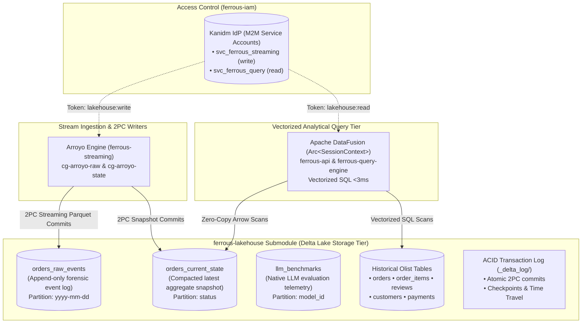

# ferrous-lakehouse

> **Relocated.** This content was the `ferrous-lakehouse` repository until 2026-11-04. It now lives in `ferrous-streaming/store/` (architecture AD-17, AD-25) with its history preserved. Paths below are relative to `store/`. Maintenance (OPTIMIZE / VACUUM) needs no credentials (Story 2.3 rework); see [Access Model](#-access-model-no-credentials-for-maintenance).

[← Back to FerrousCX Root Architecture](https://github.com/reidlai/ferrous-cx)

[](https://github.com/reidlai/ferrous-cx)
[-orange.svg)](https://delta.io/)
[](.github/workflows/devsecops-infra-ci.yml)
[](.pre-commit-config.yaml)

**`ferrous-lakehouse`** is the dedicated Open Lakehouse storage and schema catalog submodule for the **FerrousCX** enterprise platform. Built on the **Delta Lake (`delta-rs` / `delta-lake-rs`)** open table format, `ferrous-lakehouse` provides ACID transactional guarantees, versioned audit histories (`_delta_log/`), time-travel capabilities, and zero-copy Apache Arrow vectorized scans across all streaming and historical dataset partitions.

---

## 🏛️ Architecture & Role in FerrousCX

`ferrous-lakehouse` separates storage governance from stream processing and query execution:



---

## 📊 Table Catalog & Data Dictionary

| Table Name | Format | Partition Strategy | Primary Key / Index | Description |
| :--- | :--- | :--- | :--- | :--- |
| **`orders_raw_events`** | Delta Lake (Parquet) | `event_timestamp` | `payload_id` (UUIDv7) | Append-only event store capturing inbound mutation commands and Iggy payloads. |
| **`orders_current_state`** | Delta Lake (Parquet) | `status` | `order_id` (String PK) | Live materialized snapshot of active orders, current statuses, and courtesy credit totals. |
| **`llm_benchmarks`** | Delta Lake (Parquet) | `model_id` | `run_id` (UUIDv7) | Native in-process LLM benchmark evaluations (TTFT, token/s, model latencies, cost, timestamp) governed under AD-22. |
| **`olist_orders`** | Delta Lake (Parquet) | `order_status` | `order_id` | 100k Brazilian e-commerce orders for order investigation and delay radars. |
| **`olist_order_items`** | Delta Lake (Parquet) | Unpartitioned | `order_id`, `order_item_id` | Line item breakdown, prices, seller IDs, and shipping limit dates. |
| **`olist_reviews`** | Delta Lake (Parquet) | Unpartitioned | `review_id` | Customer review scores, review titles, and satisfaction comments. |
| **`olist_customers`** | Delta Lake (Parquet) | Unpartitioned | `customer_id` | Customer geographic prefixes and state locations (direct PII purged). |
| **`olist_payments`** | Delta Lake (Parquet) | Unpartitioned | `order_id`, `payment_sequential` | Payment methods, installments, and payment values. |

---

## 🔒 Access Model: No Credentials for Maintenance

The maintenance scripts (`scripts/optimize.{py,sh,ps1}` and `scripts/vacuum.{py,sh,ps1}`, and the `--maintain` / daemon modes of `entrypoint.py`) have **no application-level authentication**. They read no token, call no identity provider and need no `.env` file. Access is bounded by the container and the Delta volume instead: whoever can run the `delta-store` container, or write to the mounted `data/delta` volume, can run OPTIMIZE and VACUUM. The compose service runs rootless (UID 10001) with all capabilities dropped and `no-new-privileges`, so control access at the host / orchestrator level.

Run maintenance directly, with no environment variables set:

```bash
scripts/optimize.sh orders_current_state 128
scripts/vacuum.sh orders_current_state 168
```

Optional settings such as `LAKEHOUSE_DATA_DIR` live in `.env.example`; copy it to `.env` only if you need to override a default.

> [!NOTE]
> History: maintenance used to be gated by a token check. That check was removed in the Story 2.3 rework.

---

## ⚡ Quickstart: Local Verification (<3 Minutes)

Run the automated quickstart verification suite on your operating system:

### Windows (PowerShell)
```powershell
# Execute 1-command verification suite
.\scripts\quickstart.ps1
```

### Linux / macOS (Bash)
```bash
# Make executable and run
chmod +x ./scripts/*.sh
./scripts/quickstart.sh
```

### Individual Step Commands

#### Step 1: Validate Schemas and Audit for PII (NFR-8)
- **PowerShell**: `.\scripts\validate-schemas.ps1`
- **Bash**: `./scripts/validate-schemas.sh`

#### Step 2: Initialize Delta Lake Storage & ACID Transaction Logs (AD-17)
- **PowerShell**: `.\scripts\init-tables.ps1`
- **Bash**: `./scripts/init-tables.sh`

#### Step 3: Run Authenticated Compaction (OPTIMIZE)
- **PowerShell**: `.\scripts\optimize.ps1 -Table orders_current_state -TargetMB 128`
- **Bash**: `./scripts/optimize.sh orders_current_state 128`

#### Step 4: Run Retention Pruning (VACUUM)
- **PowerShell**: `.\scripts\vacuum.ps1 -Table orders_current_state -RetentionHours 168`
- **Bash**: `./scripts/vacuum.sh orders_current_state 168`

---

## 🐳 Containerized Orchestration (Docker Compose)

The `ferrous-lakehouse` service runs as a hardened rootless container (UID 10001) that automatically scaffolds Delta tables on boot and manages recurring OPTIMIZE and VACUUM maintenance cycles.

### Step 1: Launch the Lakehouse Container Service

#### Windows (PowerShell) & Linux / macOS (Bash)
```bash
docker compose up -d
```

### Step 2: Verify Container Health & Status
Check that the container reports `healthy`:
```bash
docker ps --filter "name=ferrous-lakehouse"
```

Expected output:
```text
CONTAINER ID   IMAGE                      STATUS                    NAMES
2b684d494610   ferrous-lakehouse:latest   Up 2 minutes (healthy)   ferrous-lakehouse
```

### Step 3: Inspect Lifecycle Logs
Monitor the automated initialization and recurring maintenance loops:
```bash
docker logs -f ferrous-lakehouse
```

### Step 4: Stop the Lakehouse Service
```bash
docker compose down
```

---

## 📁 Repository Structure

```text
ferrous-lakehouse/
├── .github/workflows/
│   └── devsecops-infra-ci.yml   # Tier 2 DevSecOps CI (hadolint, trivy, schema tests)
├── .pre-commit-config.yaml      # Shift-left hooks (gitleaks, schema audit, yaml/toml)
├── .env.example                 # Masked template for Secret Zero environment variables
├── docker-compose.yml           # Local Compose service definition
├── Dockerfile                   # Hardened storage initializer & maintenance container (UID 10001)
├── entrypoint.py                # Container lifecycle entrypoint (--init, --maintain, --daemon)
├── schemas/                     # Delta Lake Table Schemas & Arrow DDL
│   ├── streaming/               # Streaming runtime tables
│   │   ├── orders_raw_events.sql / .arrow.json
│   │   └── orders_current_state.sql / .arrow.json
│   ├── benchmarks/              # LLM evaluation runtime tables (AD-22)
│   │   └── llm_benchmarks.sql / .arrow.json
│   └── historical/              # Historical Olist benchmark tables
│       ├── olist_orders.sql
│       ├── olist_order_items.sql
│       ├── olist_reviews.sql
│       ├── olist_customers.sql
│       └── olist_payments.sql
├── config/                      # Delta Lake storage & retention configurations
│   ├── storage.toml             # Storage paths (local /data/delta or MinIO S3)
│   └── retention.toml           # VACUUM (7-day retention) and OPTIMIZE schedules
├── scripts/
│   ├── quickstart.sh / .ps1     # 1-command verification suite (<3m)
│   ├── validate-schemas.py      # Schema syntax and PII audit runner
│   ├── init_tables.py           # Delta Lake ACID log and directory initializer
│   ├── optimize.py              # Authenticated compaction (OPTIMIZE)
│   └── vacuum.py                # Authenticated retention pruning (VACUUM)
├── tests/                       # Unit test suite for storage and maintenance
│   ├── test_storage_init.py
│   └── test_maintenance.py
└── README.md                    # Submodule specification & data dictionary
```
